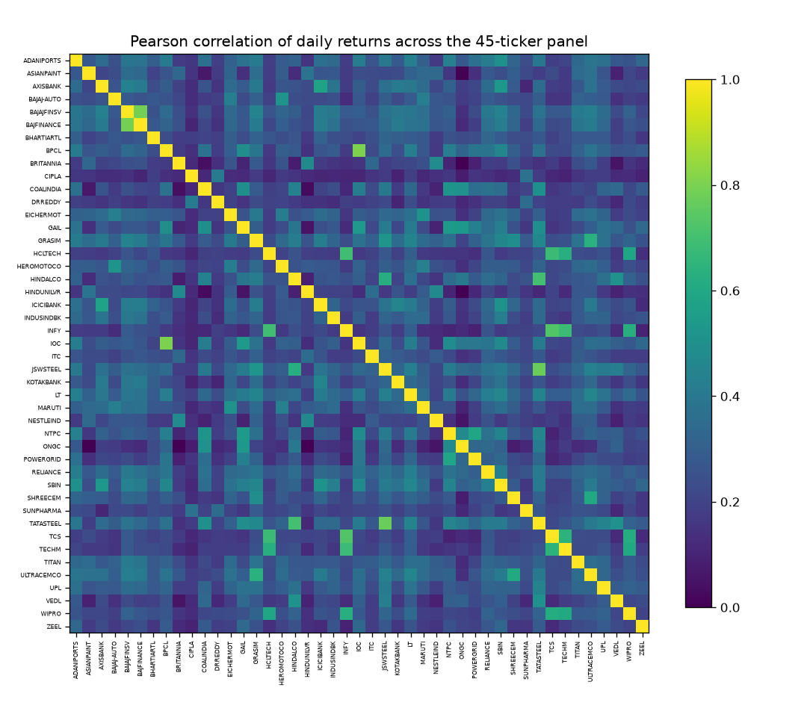
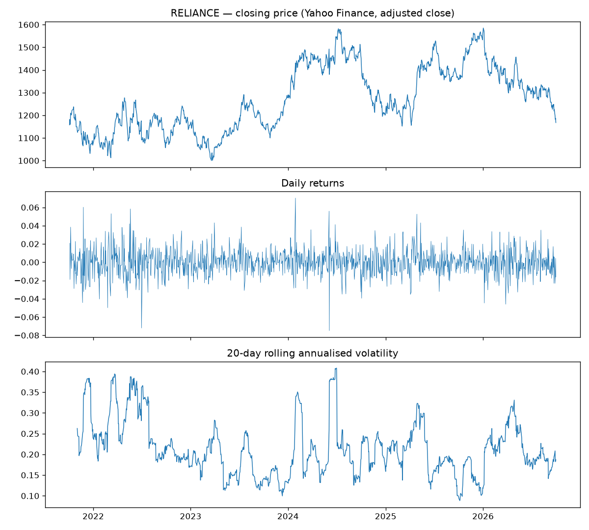
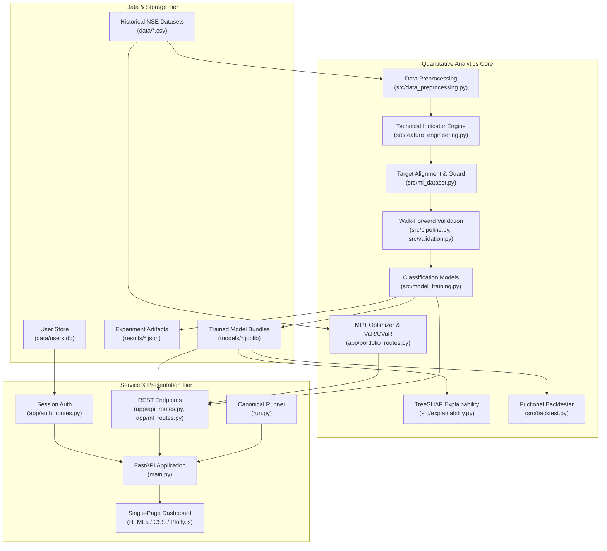

# Market ML: Financial Market Prediction & Quantitative Risk Platform

[](https://fastapi.tiangolo.com)
[](https://scikit-learn.org)
[](https://www.python.org)
[](https://www.docker.com)
[](https://docs.pytest.org)

**Market ML** is an open, modular Python platform designed for financial market analysis, supervised machine-learning experimentation, portfolio optimization, parametric risk assessment, and transaction-aware strategy evaluation.

Built around daily equity time series from the National Stock Exchange of India (NSE), the platform couples a high-performance FastAPI service and analytical web dashboard with an econometrically grounded modeling pipeline designed to eliminate contemporaneous lookahead leakage.

---

## 📑 Table of Contents

- [1. Overview](#1-overview)
- [2. Key Capabilities](#2-key-capabilities)
- [3. Visual Interface & Analytical Artifacts](#3-visual-interface--analytical-artifacts)
- [4. System Architecture](#4-system-architecture)
- [5. Technology Stack](#5-technology-stack)
- [6. Repository Structure](#6-repository-structure)
- [7. Code Navigation Guide](#7-code-navigation-guide)
- [8. Installation & Quick Start](#8-installation--quick-start)
- [9. Configuration](#9-configuration)
- [10. Using the Platform](#10-using-the-platform)
- [11. REST API Reference](#11-rest-api-reference)
- [12. Machine-Learning Methodology & Leakage Prevention](#12-machine-learning-methodology--leakage-prevention)
- [13. Verified Results & Experimental Benchmarks](#13-verified-results--experimental-benchmarks)
- [14. Testing & Reproducibility](#14-testing--reproducibility)
- [15. Local Docker Containerization](#15-local-docker-containerization)
- [16. Limitations & Responsible Use](#16-limitations--responsible-use)
- [17. Project Documentation](#17-project-documentation)
- [18. Development & Contribution](#18-development--contribution)
- [19. License](#19-license)

---

## 1. Overview

Quantitative finance applications frequently suffer from methodological defects such as contemporaneous lookahead leakage, unnormalized feature drift, and unrealistic zero-friction assumptions. 

Market ML addresses these challenges by offering an integrated, reproducible analytics environment:
- **Leakage-Safe Target Alignment:** Direction forecasting is formulated strictly for the next session ($Close_{t+1} > Close_t$) using information observable at or before session $t$.
- **Stationary Feature Transformations:** Raw price levels are stripped; models learn exclusively from scale-free returns, bounded oscillators, and normalized volatility indicators.
- **Chronological Validation:** Model selection employs expanding-window walk-forward cross validation over past sessions, reserving a terminal holdout test partition evaluated only once.
- **Frictional Strategy Backtesting:** Historical trading simulations deduct exchange, brokerage, and statutory transaction costs (10 basis points per trade), preventing the illusion of profitability from high-turnover noise.
- **Portfolio & Risk Intelligence:** Incorporates Modern Portfolio Theory (MPT) via Dirichlet Monte Carlo sampling, parametric Value-at-Risk (VaR), Expected Shortfall (CVaR), and macroeconomic stress simulations.

Market ML is designed for:
- **Researchers:** Exploring supervised learning architectures under strict chronological constraints.
- **Developers:** Building or extending financial APIs and algorithmic analytics pipelines.
- **Financial Analysts:** Evaluating portfolio diversification, risk measures, and backtested strategy curves.
- **Educators & Evaluators:** Reviewing empirical methodology, test coverage, and reproducible code.

---

## 2. Key Capabilities

### Market Data & Historical Analytics
- Bundles 5 years of clean daily OHLCV historical data (2021–2026, 55,800 records) across 45 major liquid NSE equities.
- Real-time fallback to Yahoo Finance API (`yfinance`) for live market telemetry and company fundamentals.
- Integrated automated data validation auditing completeness, date monotonicity, price positivity, and geometric domain invariants ($High \ge Low$, $High \ge Close$).

### Data Preprocessing & Feature Engineering
- 18 scale-free, stationary indicators computable strictly from historical sessions:
  - **Momentum:** 1-day, 2-day, 3-day, 5-day, 10-day, and 20-day percentage returns.
  - **Trend Deviations:** Moving average divergence ratios ($Close / \text{SMA}_{20} - 1$, $Close / \text{SMA}_{50} - 1$).
  - **Oscillators:** 14-day RSI, 14-day Williams %R, and Bollinger Band %B.
  - **Volatility:** Normalized 14-day ATR ($ATR / Close$), Bollinger Band Width, and rolling annualized return volatilities.
  - **Volume:** 1-day percentage volume change and 20-day relative volume.
- Strict prohibition of backward-filling (`bfill()`) to prevent future information leakage; rolling-window warm-up rows are dropped cleanly.

### Supervised Machine Learning & Inference
- Multiple supervised classifiers: Naive Majority Baseline, Regularized Logistic Regression (L2), Random Forest ($n=300, \text{min\_samples\_leaf}=20$), Gradient Boosted Decision Trees ($n=200$), and XGBoost ($n=300$).
- Feature standardization (`StandardScaler`) fitted strictly on training observations.
- Model persistence via `joblib` bundles paired with JSON metadata records for fast ($<15\text{ms}$) deterministic inference.

### Model Evaluation & Comparison
- Evaluates models on true chronological holdout test sets using comprehensive metrics: Accuracy, Precision, Recall, F1 Score, ROC-AUC, PR-AUC, and Confusion Matrices.
- Interactive model leaderboard comparing baseline, linear, and non-linear ensembles on the same test interval.

### Portfolio Analysis & Optimization
- Simulates the Markowitz Efficient Frontier by generating 10,000 portfolio weight vectors over the unit simplex using a Dirichlet distribution.
- Identifies the Maximum Sharpe Ratio (tangency) portfolio and Global Minimum Variance (GMV) portfolio.
- Discrete share rebalancing calculator translating continuous mathematical weights into integer share quantities and cash buffers.

### Risk Modeling & Stress Scenarios
- Computes parametric 95% 1-day Value-at-Risk (VaR) and Expected Shortfall (CVaR / Conditional VaR).
- Simulates portfolio drawdowns under macroeconomic shock scenarios (e.g., Tech Selloff, Energy Inflation, Banking Liquidity Crunch).
- Evaluates industry diversification using the Herfindahl–Hirschman Index (HHI).

### Strategy Backtesting
- Event-driven strategy backtester executing close-to-close trades conditioned on model direction probabilities ($\hat{p}_t \ge 0.5$).
- Deducts a realistic 10 basis points ($0.10\%$) execution fee per trade to account for brokerage, exchange charges, and slippage.
- Evaluates Total Return, Annualized Return, Annualized Volatility, Sharpe Ratio, Maximum Drawdown, and Win Rate against a passive Buy & Hold benchmark.

### Model Explainability
- Integrates TreeSHAP (Tree Explainer) to compute exact Shapley feature attributions on holdout test observations.
- Identifies dominant decision drivers (e.g., volume shocks and short-term momentum exhaustion) while maintaining the caveat that feature attributions represent statistical association rather than economic causality.

### Application Security & Architecture
- PBKDF2-HMAC-SHA256 password hashing with 100,000 rounds and unique 16-byte random salts.
- Parameterized SQLite credentials store (`data/users.db`) with unauthenticated user enumeration prevented.
- Cryptographically secure 24-hour session tokens (`secrets.token_hex(24)`) with automatic cache invalidation.
- Restrictive CORS configuration disallowing credentials on wildcard origins.

---

## 3. Visual Interface & Analytical Artifacts

Market ML features a responsive, dark-themed single-page analytical dashboard providing tabbed navigation across Market Telemetry, Model Evaluation, Strategy Backtesting, Portfolio Optimization, Risk Analysis, and Financial News Sentiment.

Generated exploratory data analysis and correlation artifacts produced by the platform:

| 45-Ticker Return Correlation Matrix | RELIANCE Volatility & Return Timeseries |
|:---:|:---:|
|  |  |

*Full visual analytics including class balance distributions and multi-stock panels are available in [`results/figures/`](results/figures).*

---

## 4. System Architecture

The following diagram illustrates the component architecture and data flow across Market ML:



---

## 5. Technology Stack

| Purpose | Technology / Library | Description |
|---|---|---|
| **API & Backend** | [FastAPI](https://fastapi.tiangolo.com/) | Asynchronous, OpenAPI-compliant Python web framework. |
| | [Uvicorn](https://www.uvicorn.org/) | High-performance ASGI server. |
| | [Jinja2](https://jinja.palletsprojects.com/) | Template engine for single-page dashboard delivery. |
| **Data Processing** | [Pandas](https://pandas.pydata.org/) | Time-series data structures and manipulation. |
| | [NumPy](https://numpy.org/) | Vectorized mathematical and matrix operations. |
| | [SciPy](https://scipy.org/) | Scientific statistical distributions and covariance math. |
| **Machine Learning** | [Scikit-Learn](https://scikit-learn.org/) | Classification models, preprocessors, metrics, and splitting. |
| | [XGBoost](https://xgboost.readthedocs.io/) | Regularized gradient boosted decision tree ensemble. |
| | [Joblib](https://joblib.readthedocs.io/) | Compressed model serialization and parallel compute. |
| | [SHAP](https://shap.readthedocs.io/) | Game-theoretic TreeSHAP feature attribution. |
| **Financial Analysis** | Custom Engine | Dirichlet Monte Carlo portfolio optimizer, parametric VaR/CVaR. |
| | Custom Backtester | Event-driven, 10 bps friction-aware backtesting engine. |
| | [yfinance](https://pypi.org/project/yfinance/) | Market fundamentals and fallback price feeds. |
| **Visualization** | [Plotly.js](https://plotly.com/javascript/) | Interactive client-side charting (equity curves, scatter plots). |
| | [Matplotlib](https://matplotlib.org/) / [Seaborn](https://seaborn.pydata.org/) | Automated EDA figure generation in background workflows. |
| **Security & NLP** | `hashlib` / `secrets` | PBKDF2-HMAC-SHA256 cryptographic hashing and token generation. |
| | [vaderSentiment](https://pypi.org/project/vaderSentiment/) | Lexicon-based headline sentiment analysis with financial rules. |
| **Testing & Tooling** | [Pytest](https://docs.pytest.org/) | Automated test execution framework. |
| | [Docker](https://www.docker.com/) | Multi-stage, unprivileged container packaging. |

---

## 6. Repository Structure

```text
├── app/
│   ├── api_routes.py          # Dashboard endpoints (training, backtest, explainability)
│   ├── auth_routes.py         # Session management and authentication endpoints
│   ├── forecast_routes.py     # Scenario projection routes
│   ├── ml_routes.py           # Model inventory and forward prediction endpoints
│   ├── portfolio_routes.py    # Monte Carlo MPT optimizer, discrete shares, VaR/CVaR
│   ├── static/                # Dark-themed CSS (style_v3.css) and UI scripts (script_v52.js)
│   └── templates/             # Single-page application dashboard template (index.html)
├── data/                      # 45 liquid NSE equity daily OHLCV datasets (2021–2026)
├── docs/                      # Technical documentation suite (reports, logs, methodology)
├── models/                    # Persisted joblib bundles and companion metadata records
├── results/                   # Reproducible evaluation outputs, data quality audits, and EDA plots
│   └── figures/               # Generated figures (correlation matrix, timeseries plots)
├── scripts/
│   └── run_experiments.py     # Reproducible EDA and walk-forward experiment runner
├── src/
│   ├── auth.py                # Cryptographic hashing, user storage, and session logic
│   ├── backtest.py            # Frictional backtesting engine (Sharpe, MDD, Win Rate)
│   ├── data_preprocessing.py  # Local CSV loading, caching, and price validation
│   ├── dataset_builder.py     # Portable panel dataset generator
│   ├── explainability.py      # TreeSHAP Shapley feature attribution
│   ├── feature_engineering.py # Indicator calculations (RSI, Bollinger Bands, ATR, returns)
│   ├── ml_dataset.py          # Direction target alignment and scale-free feature guard
│   ├── model_training.py      # Classification models and multi-metric evaluations
│   ├── pipeline.py            # Chronological splitting, walk-forward CV, and persistence
│   ├── sentiment_analysis.py  # News headline sentiment scoring with finance lexicon rules
│   └── validation.py          # Chronological walk-forward split generator
├── tests/                     # Automated pytest suite (25 passing tests)
├── .dockerignore              # Container build context exclusions
├── .gitignore                 # Caches, virtual environments, and generated artifact exclusions
├── docker-compose.yml         # Container orchestration with volume mounts
├── Dockerfile                 # Multi-stage non-root container configuration
├── main.py                    # FastAPI ASGI application definition
├── requirements.txt           # Python dependency specification
└── run.py                     # Canonical CLI runner and environment diagnostic tool
```

---

## 7. Code Navigation Guide

Direct links to key implementations in the repository:

| Functional Area | Source File | Key Symbols / Endpoints | Line Range |
|---|---|---|---|
| **Application Entrypoint** | [`run.py`](run.py) | `check_environment`, `start_server` | [L36–L180](run.py#L36-L180) |
| **FastAPI App & Routing** | [`main.py`](main.py) | `app`, CORS configuration | [L13–L55](main.py#L13-L55) |
| **Target Alignment** | [`src/ml_dataset.py`](src/ml_dataset.py) | `create_next_day_direction_target` | [L17–L44](src/ml_dataset.py#L17-L44) |
| **Feature Leakage Guard** | [`src/ml_dataset.py`](src/ml_dataset.py) | `verify_no_lookahead`, `MODEL_FEATURES` | [L48–L96](src/ml_dataset.py#L48-L96) |
| **Indicator Calculations** | [`src/feature_engineering.py`](src/feature_engineering.py) | `add_technical_indicators`, `create_features` | [L71–L216](src/feature_engineering.py#L71-L216) |
| **Chronological Split** | [`src/pipeline.py`](src/pipeline.py) | `split_chronological_three_way` | [L78–L88](src/pipeline.py#L78-L88) |
| **Walk-Forward CV** | [`src/pipeline.py`](src/pipeline.py) | `walk_forward_model_selection` | [L91–L119](src/pipeline.py#L91-L119) |
| **Model Persistence** | [`src/pipeline.py`](src/pipeline.py) | `train_and_persist`, `_clean_for_json` | [L133–L200](src/pipeline.py#L133-L200) |
| **Fast Inference Engine** | [`src/pipeline.py`](src/pipeline.py) | `predict_next_session`, `load_model_bundle` | [L203–L233](src/pipeline.py#L203-L233) |
| **Classification Models** | [`src/model_training.py`](src/model_training.py) | `train_classification_models` | [L80–L189](src/model_training.py#L80-L189) |
| **Evaluation Metrics** | [`src/model_training.py`](src/model_training.py) | `evaluate_classification` | [L41–L77](src/model_training.py#L41-L77) |
| **TreeSHAP Attribution** | [`src/explainability.py`](src/explainability.py) | `get_global_feature_importance` | [L73–L122](src/explainability.py#L73-L122) |
| **Friction Backtesting** | [`src/backtest.py`](src/backtest.py) | `Backtester.run`, `get_metrics` | [L46–L115](src/backtest.py#L46-L115) |
| **Portfolio Optimizer** | [`app/portfolio_routes.py`](app/portfolio_routes.py) | `analyze_portfolio` | [L40–L150](app/portfolio_routes.py#L40-L150) |
| **Password Security** | [`src/auth.py`](src/auth.py) | `hash_password`, `verify_password` | [L42–L53](src/auth.py#L42-L53) |
| **Auth Session API** | [`app/auth_routes.py`](app/auth_routes.py) | `get_current_user`, `login`, `signup` | [L50–L160](app/auth_routes.py#L50-L160) |
| **Dashboard Model API** | [`app/api_routes.py`](app/api_routes.py) | `train_model`, `run_backtest`, `get_explainability` | [L142–L455](app/api_routes.py#L142-L455) |
| **Forward Prediction API**| [`app/ml_routes.py`](app/ml_routes.py) | `predict_ticker`, `evaluate_ticker` | [L100–L148](app/ml_routes.py#L100-L148) |

---

## 8. Installation & Quick Start

### Prerequisites
- Python 3.10, 3.11, 3.12, or 3.14.
- `pip` package manager.
- Git.

### 1. Clone the Repository
```bash
git clone https://github.com/naman00008/financial-market-prediction.git
cd financial-market-prediction
```

### 2. Set Up a Virtual Environment
```bash
# On Linux / macOS
python3 -m venv venv
source venv/bin/activate

# On Windows (PowerShell)
python -m venv venv
.\venv\Scripts\Activate.ps1
```

### 3. Install Dependencies
```bash
python -m pip install -r requirements.txt
```

### 4. Verify System Readiness
Run the built-in diagnostic verifier:
```bash
python run.py --check
```
This inspects packages, checks local data integrity across all 45 equities, verifies static assets, and confirms model bundle readiness.

### 5. Start the Application
```bash
python run.py
```
Open **`http://127.0.0.1:8000/`** in your browser.

---

## 9. Configuration

Market ML operates with safe local defaults and requires no mandatory external configuration. Optional environment variables can be set:

| Variable | Default | Purpose |
|---|---|---|
| `HOST` | `127.0.0.1` | Network interface to bind (`0.0.0.0` for containerization). |
| `PORT` | `8000` | Port number for the HTTP server. |
| `SESSION_TTL_SECONDS` | `86400` | In-memory authentication session lifetime in seconds (24 hours). |

All stock data is bundled locally under `data/*.csv`. The system does not depend on cloud storage or external databases for standard local operation.

---

## 10. Using the Platform

### Interactive Web Dashboard (`http://127.0.0.1:8000/`)
1. **Explore Stocks:** Use the stock selector dropdown in the navigation header to choose from 45 liquid NSE equities (e.g., `RELIANCE`, `TCS`, `INFY`, `HDFCBANK`). Real-time profile metrics and financial summaries load dynamically.
2. **Model Evaluation:** Navigate to the **Model Eval** tab and click **"Train Models Now"**. The platform instantly retrieves verified walk-forward selection metrics and holdout evaluation scores from persisted model metadata, updating the leaderboard table and Plotly prediction vs. actual charts.
3. **Strategy Backtest:** Open the **Strategy Backtest** tab and click **"Run Backtest"**. The platform simulates trading conditioned on out-of-sample model signals, deducting a 10 bps transaction fee per trade, and displays comparative equity curves alongside Sharpe Ratio, Max Drawdown, and Win Rate.
4. **Portfolio Optimizer:** In the **Portfolio Optimizer** tab, select candidate equities and allocate capital (e.g., ₹10,00,000). The engine runs 10,000 Monte Carlo iterations, displaying the efficient frontier, optimal Sharpe weights, and discrete whole-share order allocations.
5. **Risk Analysis:** View 95% 1-day Value-at-Risk (VaR), Expected Shortfall (CVaR), and simulate macroeconomic sector shock scenarios.
6. **Authentication:** Create an account or sign in via the secure modal to access protected analytical features.

---

## 11. REST API Reference

Interactive OpenAPI documentation is available when running the application at:
- **Swagger UI:** `http://127.0.0.1:8000/docs`
- **ReDoc:** `http://127.0.0.1:8000/redoc`

### Core Endpoints

#### `GET /api/health`
Healthcheck endpoint returning server operational status.
- **Auth:** None
- **Response:**
  ```json
  {"status": "ok", "message": "Market ML API is online"}
  ```

#### `GET /api/stocks`
Returns a list of all 45 supported NSE ticker symbols.
- **Auth:** None
- **Response:** `["ADANIPORTS", "ASIANPAINT", "AXISBANK", ..., "ZEEL"]`

#### `GET /api/data/{ticker}`
Retrieves historical OHLCV data and technical indicators for the specified stock.
- **Auth:** None
- **Parameters:** `ticker` (string, e.g., `RELIANCE`)

#### `POST /api/train/{ticker}`
Returns holdout evaluation metrics, walk-forward CV summaries, and test visualization series for the specified stock from persisted artifacts.
- **Auth:** Optional / Session-gated
- **Response:** Includes `models` (Accuracy, Precision, Recall, F1, ROC-AUC, Confusion Matrix), `best_model`, `dates`, `y_test`, and `y_pred`.

#### `GET /api/backtest/{ticker}`
Executes a chronological holdout backtest of the selected model against a Buy & Hold benchmark with 10 bps transaction frictions.
- **Auth:** Optional / Session-gated
- **Response:** Includes `curve` (daily strategy and benchmark equity) and `metrics` (Total Return, Annualized Return, Sharpe Ratio, Max Drawdown, Win Rate, Trades Executed).

#### `GET /api/explain/{ticker}`
Returns the top 15 TreeSHAP global feature attributions computed on holdout test data.
- **Auth:** Optional / Session-gated
- **Response:**
  ```json
  {
    "importances": {
      "Volume_Change_1d": 0.0296,
      "RSI_14": 0.0211,
      "Return_3d": 0.0176,
      "BB_Width_20": 0.0117
    },
    "model": "RELIANCE",
    "method": "TreeSHAP"
  }
  ```

#### `GET /api/ml/predict/{ticker}`
Generates a forward-looking next-session direction prediction using the persisted model bundle and the most recent completed market data.
- **Auth:** None
- **Response:**
  ```json
  {
    "status": "success",
    "ticker": "RELIANCE",
    "model": {
      "algorithm": "random_forest",
      "holdout_accuracy": 0.5225,
      "holdout_roc_auc": 0.5494
    },
    "prediction": {
      "prediction": 1,
      "probability_up": 0.5475,
      "as_of_date": "2026-10-01"
    }
  }
  ```

#### `POST /api/portfolio/analyze`
Computes the Dirichlet Monte Carlo efficient frontier, discrete share allocation, parametric VaR, CVaR, and sector concentration.
- **Auth:** None
- **Payload:**
  ```json
  {
    "tickers": ["RELIANCE", "TCS", "HDFCBANK"],
    "capital": 1000000,
    "risk_free_rate": 0.065
  }
  ```

#### `POST /api/auth/signup` and `POST /api/auth/login`
Account creation and authentication returning a cryptographically secure 24-hour session token.
- **Payload:** `{"username": "...", "password": "..."}`
- **Response:** `{"status": "success", "token": "<48-char-hex-token>", "user": {...}}`

---

## 12. Machine-Learning Methodology & Leakage Prevention

```
Raw OHLCV Series (5 Years, 45 Equities)
   │
   ▼
Forward-Only Feature Engineering (src/feature_engineering.py)
   ├── Drops raw price levels (Open, High, Low, Close, Volume)
   ├── Computes 18 scale-free percentage returns, ratios, oscillators
   └── Discards warm-up NaN rows (Strictly NO backward-fill)
   │
   ▼
Target Alignment (src/ml_dataset.py)
   ├── Labels: Target_t = 1 if Close_{t+1} > Close_t else 0
   └── Drops terminal session (Unobserved future session)
   │
   ▼
Chronological Splitting (src/pipeline.py)
   ├── 70% Train ───┐
   │                ├─► Fit Scaler & 4-Fold Walk-Forward Model Selection
   ├── 15% Val   ───┘
   │
   └── 15% Holdout Test ───► Scored Exactly Once (Never used for selection)
```

### Leakage Prevention Mechanisms
1. **Elimination of Contemporaneous Bounds:** Regressing same-day $Close_t$ on same-day $Open_t, High_t, Low_t$ produces trivial $R^2 \approx 0.999$ because $Low_t \le Close_t \le High_t$. Market ML eliminates this defect by framing the problem strictly as next-session direction classification ($Close_{t+1} > Close_t$).
2. **Prohibition of `bfill()`:** Rolling windows naturally generate initial missing values (e.g., 50 days for `SMA_50`). Backward-filling copies future information into past timestamps. Market ML prunes warm-up rows forward in time via `.dropna()`.
3. **Training-Only Scaler Fitting:** Feature scaling via `StandardScaler` is fitted exclusively on training observations. Applying transforms using pre-fitted parameters prevents future distribution parameters ($\mu, \sigma$) from leaking into training folds.
4. **Chronological Expanding Windows:** Row shuffling is prohibited. Walk-forward cross validation trains strictly on past sessions and validates on subsequent periods.

---

## 13. Verified Results & Experimental Benchmarks

All results are backed by machine-readable artifacts generated under `results/` and persisted models in `models/`.

### 1. Cross-Sectional Pooled Panel Experiment (55,755 Supervised Samples)
Evaluated across all 45 equities over an identical chronological holdout window:

| Model Architecture | Hyperparameters | Holdout Accuracy | Edge vs Baseline |
|---|---|---:|---:|
| **Majority-Class Baseline** | Constant class from training | $47.23\%$ | Benchmark |
| **Random Forest** | $n=300, \text{min\_leaf}=20$ | $48.86\%$ | $+1.63\%$ |
| **Gradient Boosting** | $n=200, \text{lr}=0.05, d=3$ | $48.91\%$ | $+1.68\%$ |
| **Logistic Regression** | L2 Regularized, $C=1.0$ | $49.21\%$ | $+1.98\%$ |
| **XGBoost** | $n=300, \text{lr}=0.05, d=4$ | **$49.37\%$** | **$+2.14\%$** |

*Note: The holdout period coincided with an aggregate market correction where down sessions accounted for 52.77% of total observations. All four learning algorithms outperformed the naive baseline.*

### 2. Benchmark Single Equity: RELIANCE (178 Holdout Test Sessions)
Evaluated on the terminal 15% out-of-sample window:

| Model | Accuracy | Precision | Recall | F1 Score | ROC-AUC | PR-AUC |
|---|---:|---:|---:|---:|---:|---:|
| **Majority Baseline** | $50.56\%$ | $50.56\%$ | $100.0\%$ | $0.672$ | $0.5000$ | $0.5056$ |
| **Gradient Boosting** | $50.00\%$ | $46.15\%$ | $44.44\%$ | $0.453$ | $0.5082$ | $0.4815$ |
| **Logistic Regression** | $51.69\%$ | $47.83\%$ | $61.11\%$ | $0.537$ | $0.5218$ | $0.4892$ |
| **Random Forest** | **$52.25\%$** | **$48.31\%$** | **$70.37\%$** | **$0.573$** | **$0.5494$** | **$0.5117$** |

### 3. Frictional Backtesting Results (RELIANCE Holdout)
- **Signal Rule:** Long from close $t$ to close $t+1$ if predicted probability $\hat{p}_t \ge 0.5$; cash otherwise.
- **Transaction Friction:** 10 bps ($0.10\%$) per trade.
- **Strategy Performance:** Net Return: **$-23.52\%$** (118 trades executed) vs Buy & Hold Benchmark: **$-19.17\%$**.
- **Sharpe Ratio:** $-1.625$ vs $-1.184$ (Benchmark).
- **Finding:** While the model exhibits genuine statistical edge in direction classification ($52.25\% > 50.56\%$), high portfolio turnover without confidence thresholding incurs transactional drag that negates gross alpha. This empirical finding demonstrates the critical necessity of transaction cost modeling.

---

## 14. Testing & Reproducibility

Market ML includes an automated test suite verifying data integrity, feature math, leakage guards, backtest logic, and authentication security.

### Run All Unit and Integration Tests
```bash
python -m pytest
```

### Current Test Suite Verification Status
**25 passed** across all 10 test modules in ~9.2 seconds:

| Test Module | Tests | Scope Verified |
|---|---:|---|
| [`tests/test_ml_pipeline_leakage.py`](tests/test_ml_pipeline_leakage.py) | 5 | Target alignment, lookahead guard, chronological 3-way split, walk-forward order, persistence. |
| [`tests/test_auth_system.py`](tests/test_auth_system.py) | 5 | PBKDF2 hashing, user persistence, enumeration rejection, session expiry, no plaintext dossiers. |
| [`tests/test_market_ml_models.py`](tests/test_market_ml_models.py) | 2 | Classification metric evaluation functions and regression compatibility signatures. |
| [`tests/test_technical_indicators.py`](tests/test_technical_indicators.py) | 1 | Indicator calculation consistency (RSI, MACD, Bollinger Bands) without lookahead bias. |
| [`tests/test_model_explainability.py`](tests/test_model_explainability.py) | 2 | Global feature importance and TreeSHAP matrix handling. |
| [`tests/test_sentiment_engine.py`](tests/test_sentiment_engine.py) | 2 | Financial lexicon sentiment scoring and polarity classification. |
| [`tests/test_market_api_routes.py`](tests/test_market_api_routes.py) | 3 | API health, ticker universe listing, and profile telemetry endpoints. |
| [`tests/test_market_etl_pipeline.py`](tests/test_market_etl_pipeline.py) | 2 | Data loading, price bounds validation, and date sorting. |
| [`tests/test_portfolio_optimizer_routes.py`](tests/test_portfolio_optimizer_routes.py) | 1 | Dirichlet Monte Carlo efficient frontier, discrete shares, and VaR/CVaR calculations. |
| [`tests/test_s3_readiness.py`](tests/test_s3_readiness.py) | 2 | Dataset directory structure and CSV file availability checks. |

### Reproducing Data Quality Audits & Exploratory Plots
```bash
python scripts/run_experiments.py eda
```
Generates `results/data_quality.json` and multi-panel figures under `results/figures/`.

### Reproducing Full Walk-Forward Model Experiments
```bash
python scripts/run_experiments.py run
```
Executes walk-forward cross validation and holdout evaluation across all 45 equities and updates `results/experiment_results.json`. *(Pre-trained models already exist under `models/`; running this script is optional).*

---

## 15. Local Docker Containerization

Market ML can be run locally using Docker for an isolated, consistent runtime environment.

### Prerequisites
- Docker Engine / Docker Desktop installed and running locally.
- Docker Compose v2+.

### Build and Run with Docker Compose (Recommended)
Docker Compose mounts local datasets, models, and results for immediate availability without retraining:
```bash
# Build image and start container
docker compose up --build

# Run in detached mode (background)
docker compose up -d

# View live application logs
docker compose logs -f

# Stop container
docker compose down
```

### Build and Run with Docker CLI
```bash
# Build image locally
docker build -t market-ml .

# Run container mapping port 8000
docker run -d --name market-ml-app -p 8000:8000 market-ml

# Inspect logs
docker logs -f market-ml-app

# Stop and remove container
docker stop market-ml-app && docker rm market-ml-app
```

The containerized service will be accessible at **`http://localhost:8000/`**.

---

## 16. Limitations & Responsible Use

### Analytical & Research Scope
Market ML is designed as an educational, analytical, and research platform. It does not provide personalized investment advice, commercial trade execution, or financial recommendations.

### Key Practical Limitations
1. **Low Signal-to-Noise Ratio:** Liquid equity markets exhibit dynamics close to random walks on daily frequencies. Out-of-sample directional accuracy between 52% and 55% represents a typical statistical anomaly; it does not constitute a guaranteed trading edge.
2. **Transaction Frictions:** Daily rebalancing generates significant frictional drag. Unfiltered trading on every directional signal is typically unprofitable after accounting for brokerage, statutory taxes, and execution slippage.
3. **Probability Calibration:** Classifier probability estimates are uncalibrated model scores and should not be treated as true Bayesian market probabilities.
4. **Market Regime Shifts:** Models trained on historical data may degrade during unprecedented macroeconomic shocks, regulatory shifts, or liquidity events.
5. **SHAP Interpretation:** Shapley feature attributions indicate statistical association within trained decision trees, not macroeconomic causation.

---

## 17. Project Documentation

Comprehensive documentation deliverables are organized under [`docs/`](docs):

### Technical & Methodological Reports
- [`docs/PROBLEM_STATEMENT.md`](docs/PROBLEM_STATEMENT.md) — Mathematical problem formulation, EMH context, and lookahead leakage diagnosis.
- [`docs/DATASET_DOCUMENTATION.md`](docs/DATASET_DOCUMENTATION.md) — 45-stock dataset schema, column definitions, and acquisition provenance.
- [`docs/DATA_QUALITY_REPORT.md`](docs/DATA_QUALITY_REPORT.md) — Automated data quality audit results (null checks, duplicate checks, boundary invariants).
- [`docs/MODEL_EVALUATION.md`](docs/MODEL_EVALUATION.md) — Benchmark methodology, multi-metric scoring suite, and TreeSHAP analysis.
- [`docs/EXPERIMENT_LOG.md`](docs/EXPERIMENT_LOG.md) — Reproducible logs for pooled and per-ticker runs, including negative results.
- [`docs/FINAL_PROJECT_REPORT.md`](docs/FINAL_PROJECT_REPORT.md) — Detailed academic case study report.

### Evaluation & Academic Annex
- [`docs/PRESENTATION_PLAN.md`](docs/PRESENTATION_PLAN.md) — Project defense slide outline and step-by-step live demonstration script.
- [`docs/VIVA_PREPARATION.md`](docs/VIVA_PREPARATION.md) — 45 technical questions and code-verified answers across all quantitative and engineering modules.
- [`docs/ESE_RUBRIC_TRACEABILITY.md`](docs/ESE_RUBRIC_TRACEABILITY.md) — Traceability matrix mapping implementations to evaluation criteria.
- [`docs/PROJECT_AUDIT.md`](docs/PROJECT_AUDIT.md) — Initial codebase audit diagnosing historical defects and remediation milestones.

---

## 18. Development & Contribution

### Running Code Quality & Imports Check
```bash
python -c "import main, run, src.pipeline, src.ml_dataset, src.backtest; print('All core modules imported successfully.')"
```

### Adding New Technical Indicators
1. Add the calculation function in [`src/feature_engineering.py`](src/feature_engineering.py) using forward-only rolling windows.
2. If scale-free, register the indicator column name in `MODEL_FEATURES` in [`src/ml_dataset.py`](src/ml_dataset.py).
3. If it contains raw price levels, register it under `EXCLUDED_FROM_MODEL` to enforce leakage protection.
4. Add corresponding test assertions in [`tests/test_technical_indicators.py`](tests/test_technical_indicators.py).

### Adding New Classification Models
1. Add the estimator configuration to `train_classification_models` in [`src/model_training.py`](src/model_training.py).
2. Ensure the model outputs probabilities via `.predict_proba()` and extracts `.feature_importances_` where applicable.
3. Add a corresponding test in [`tests/test_market_ml_models.py`](tests/test_market_ml_models.py).

---

## 19. License

No license has been specified for this project. All rights are reserved by the original author.
